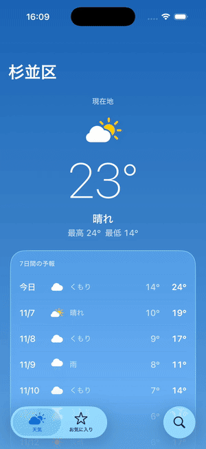
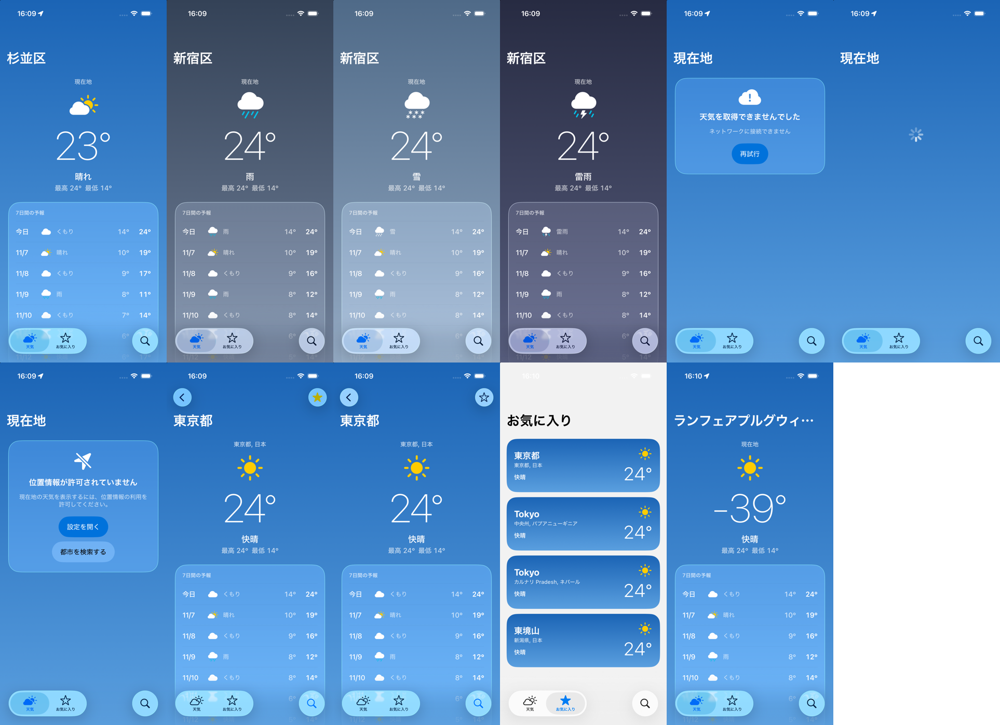

# reflex-expo-app

[English](README.md) | 日本語

Shopify の [Reflex](https://shopify.engineering/reflex)（エージェントがコードの大半を書く前提で、シミュレータなしの速いフィードバックループを作るアーキテクチャ）の考え方を、Expo（React Native）に持ち込めるかを試した検証用アプリです。

題材は天気アプリです。現在地の天気、都市検索、お気に入りの3タブがあり、iOS 26 の Liquid Glass に合わせた見た目にしています。

- API：[Open-Meteo](https://open-meteo.com/)（API キー不要）
- ネイティブ機能：expo-location（位置情報の許可、現在地、逆ジオコーディング）、expo-sqlite/kv-store（お気に入りの保存）
- UI：Expo Router の NativeTabs と native Stack、Expo UI（SwiftUI）の `glassEffect`、SF Symbols（マルチカラー）

## デモ

シミュレータのアプリを、ボタンを一度も押さずに Metro のデバッガー（CDP）から操作しています。天気を雨や雪に変え、通信を切り、位置情報を拒否し、検索から詳細画面まで進めています。



（iPhone 17 Pro / iOS 26.5 シミュレータ、Expo Go。[MP4 版](docs/cdp-demo/demo.mp4)、詳しくは [docs/cdp-demo](docs/cdp-demo/README.ja.md)）

11 の画面パターンを 26 秒で撮ったもの：



## 概要

Reflex の柱を、Expo では次のように置き換えました。

| Reflex | このリポジトリ |
|---|---|
| UI を持たない Core（Swift パッケージ / JVM モジュール） | `src/core`：React・React Native・Expo を import しない TypeScript |
| Elm 風の厳格な ViewModel（Action in / State out） | 画面ごとのストア。状態を変えるのは純粋な `update` だけで、外に出すのは `send(action)` だけ |
| サービスのコンストラクタ注入 | `Deps`（API、位置情報、保存、ナビゲーション）を画面のファクトリに渡す |
| Introspection Kit（name / state / actions） | `describeScreen()`：`ls` と `do` の共通部分 |
| CLI（`ls` / `do`） | `pnpm app-cli`（ヘッドレス）と、開発ビルドの `globalThis.__app`（シミュレータ） |
| 振る舞いテスト（ネットワーク遮断、フィクスチャ必須、モック不使用） | jest-expo 上のハーネス。`fetch` は常に失敗させ、Open-Meteo の実レスポンスを保存したフィクスチャを注入する |

Reflex は「iOS と Android でコードを2回書き、テストを共有する」ことでプラットフォーム間の一致を担保していました。RN はコードベースが1つなので、その動機は薄れます。一方、「シミュレータなしで振る舞いを速く検証・探索できる」価値はそのまま残る、というのがこの検証の前提です。

### ナビゲーションはどうしたか

Expo Router のナビゲーション状態は UI 側（`_layout.tsx` の JSX）にあり、完全にヘッドレスでは動かせません。そこで、`expo-router/testing-library` の `renderRouter` に **`src/app` をそのまま渡し、画面のファイルだけを `() => null` に差し替える** ことにしました。

- 描画されるのは本物のレイアウト（ナビゲーター）だけです。遷移、タブ、戻る操作は実際のアプリと同じになります。
- 画面のロジックはストアにあるので、画面を描かなくても `ls` / `do` で操作できます。
- 「今の画面」は segments から `src/core/screens/registry.ts` を引いて決めます。

ハーネスは、アプリの次の2つの規則も同じように再現します。

- **画面の寿命**：ストアはルーターの route ごとに持ちます。Stack から pop されたら捨てます（アンマウントと同じ）。
- **フォーカス**：フォーカスが移るたびに `Appear` を送ります（アプリ側は `useFocusEffect`）。

## 構成

```
src/
├── app/        ルート（Expo Router）。画面の見た目だけ
├── core/       UI なし・React なし・Expo なし（Node でそのまま動く）
│   ├── store.ts      createStore と Screen 型
│   ├── inspect.ts    ls / do の共通部分
│   ├── deps.ts       注入する依存の型（Api / Location / Favorites / Nav）
│   ├── api.ts        Open-Meteo クライアント（fetch を注入）
│   └── screens/      画面ごとの ViewModel と registry
├── platform/   依存の本番実装（expo-location、kv-store、expo-router）
├── ui/         見た目の部品（Expo UI / Liquid Glass）と React 側の接着（use-screen）
└── dev/        開発専用（フィクスチャ、フェイク、シナリオ、__app）
test/           ハーネス、振る舞いテスト、境界テスト
scripts/        app-cli
```

`src/core` が UI や Expo を import しないことは、`test/boundaries.test.ts` で確かめています。

画面のストアは次の形です（`src/core/screens/weather.ts` から抜粋）。

```ts
export function createWeatherScreen(deps: Deps): Screen<WeatherState, WeatherAction> {
  const store = createStore<WeatherState, Msg>({ status: 'idle' }, update);
  return {
    name: 'Weather',
    actions: ['Appear', 'Retry', 'OpenSettings', 'OpenSearch'],
    getState: store.getState,
    subscribe: store.subscribe,
    hydrate: store.replace, // 開発用
    async send(action) {
      // 副作用は deps を呼び、結果を Msg として update に戻す
    },
  };
}
```

コンポーネントは購読して `send` するだけです。

```tsx
const [state, send] = useScreen(() => createWeatherScreen(deps));
```

## 動かす

```bash
pnpm install
pnpm start          # Expo Go で開く（Liquid Glass は iOS 26 以上）
pnpm test           # 振る舞いテスト（シミュレータ不要）
```

### シミュレータなしで操作する（app-cli）

```bash
pnpm app-cli ls
pnpm app-cli --url /search do ChangeQuery '{"query":"Tokyo"}' do Submit do Open '{"id":1850147}'
pnpm app-cli --scenario location-denied ls do OpenSearch
```

```
$ ls
  /  Weather
  state:   {"status":"permissionDenied","canAskAgain":false}
  actions: Appear, Retry, OpenSettings, OpenSearch
$ do OpenSearch
  /search  Search
  state:   {"query":"","status":"idle","results":[],"favorites":[]}
  actions: Appear, ChangeQuery, Submit, Open
```

1 回の呼び出しごとにアプリを起動し直すので、続けて操作するときはコマンドを並べます。

### ネイティブ版と同じテストを流す

同じ天気アプリを Swift と Kotlin でも作っています（リポジトリは未公開）。その振る舞いテストは、このアプリにもそのまま流せます。`test/protocol.test.tsx` がハーネスの中で同じ NDJSON（`launch` / `ls` / `do` / `env`）を TCP で話すアダプターです。

```bash
REFLEX_PORT=8770 npx jest --no-watchman test/protocol.test.tsx   # 127.0.0.1:8770 で待ち受ける
```

ネイティブ版ではタブの切り替え（`SelectTab`）と戻る（`Back`）をナビゲーターが貸すので、アダプターが expo-router の遷移に置き換えています。アクションの入力は、画面の `inputs` に書いた型で `send` の前に確かめます（Reflex の入力スキーマに当たる部分）。

### シミュレータで動くアプリを操作する（__app）

開発ビルドでは `globalThis.__app` を公開しています。Metro のデバッガー（CDP）から呼びます。本番のバンドルには含まれません。

```js
__app.ls()                        // 今の画面の state と actions
__app.do('Open', { id: 1850147 }) // アクションを送る（ボタンは経由しない）
__app.go('/favorites')            // 遷移する（タブのタップ・ディープリンク相当）
__app.scenario('rainy')           // 依存をシナリオに差し替える（'default' で元に戻す）
__app.hydrate({ ... })            // 今の画面の state を直接入れる
```

シナリオ（`src/dev/scenarios.ts`）は app-cli と共通です。

| シナリオ | 内容 |
|---|---|
| `fixtures` | ネットワークを使わず、いつも同じデータ |
| `rainy` / `snowy` / `stormy` | 天気を書き換えたフィクスチャ |
| `many-favorites` | お気に入りが複数 |
| `offline` | 通信できない |
| `loading` | 応答が返ってこない |
| `location-denied` | 位置情報を拒否済み |

シナリオは注入する依存を差し替えるだけなので、state は正規の `update` を通って作られます。そのため、実際に起こりうる画面だけを再現できます。

## わかったこと

### 速さ

同じタスク（検索 → 詳細 → お気に入りを切り替え → 戻る → お気に入りタブで確認）を3つの方法で実行しました。

| 方法 | 操作そのもの | エージェントから見た時間 | ツール呼び出し |
|---|---|---|---|
| app-cli（ヘッドレス） | 7操作で約50ms | 2.3〜3.0秒（ほぼ jest の起動） | 1回 |
| `__app` を CDP で1操作ずつ | 7操作で275ms | 14.0秒 | 8回 |
| argent で UI 操作（座標を知っている最良のケース） | 約3.2秒 | 10.0秒 | 1回 |

振る舞いテストは19本で、合計約0.8秒です（1本 5〜85ms）。

エージェントにとって効くのは「ツールを何回呼ぶか」でした。CLI はコマンドを並べて1回で流せるのが大きいです。UI 操作は、初めて触る画面だと各手順で座標を探すので、呼び出しが10〜20回に増えます。

### ヘッドレスで見つかるもの、実機でしか見つからないもの

**ヘッドレスのテストで再現し、回帰を防げたもの**

- 設定で位置情報を許可して戻っても、拒否の表示のまま
- 一度読み込めたら、タブを行き来しても取り直さない
- iOS では1回拒否すると二度と聞けない（`canAskAgain: false`）。これはフェイクを書き換えるだけでテストできます

**実機（シミュレータ）でしか見つからなかったもの**

- 速く打つと文字が入れ替わる。入力値をストア経由で TextInput に戻していたのが原因です
- アイコンから開くと検索タブで起動してしまう。ルートの `anchor` で直しました。ハーネスはどの URL でも正しいタブで起動するため、ヘッドレスでは再現しません
- 雪の空でカードの文字が読めない。シナリオで画面のパターンを並べて見つけました

振る舞いはヘッドレスで、見た目と配線は実機で、という Reflex と同じ切り分けになりました（Reflex は見た目を Helix のビジュアルレビューで担保しています）。

おすすめの使い分けは次のとおりです。

- **目的の画面まで進める、状態を用意する**：`do` / `scenario` で一気に進める
- **見た目と配線を確かめる**：そこから先だけ、タップとスクリーンショットで確認する

### 設計で決めたこと

- **状態管理ライブラリは使っていません**。手書きの `createStore` は約20行で、`zustand/vanilla` とほぼ同じです。Zustand は `setState` を公開するので、「外に出すのは `send` だけ」というルールでは隠す手間が増えます。
- **画面をまたぐ状態は「保存先が正、フォーカスのたびに読み直す」で済ませています**。お気に入りは3画面にまたがりますが、どの画面も `Appear` で kv-store から読み直します。画面どうしが互いを知らずに済み、テストも画面単位で閉じます。2つの画面が同時に見えて即座に同期させたいときなど、アプリ全体で共有するストアが必要になったら、`zustand/vanilla` を `Deps` として注入するのが自然だと思います。
- **monorepo にはしていません**。ハーネスは本物の expo-router を描画するので、core を別パッケージにしてもテストは jest-expo 上で動かすことになります。境界は `test/boundaries.test.ts` で守っています。
- **iOS 専用の見た目は `.ios.tsx` に分けています**。Expo UI（SwiftUI）の部品は `.ios.tsx` に置き、同じ名前の `.tsx` に Android 用の代替を置いています。Android の実機では未確認です。

## 未対応・今後

- app-cli は呼び出しごとに jest を起動するので、1回あたり約2秒かかります。ハーネスを起動したまま待ち受ける REPL にすれば、1操作が数 ms で返るはずです。
- ESLint は未設定です。core の境界は lint のルール（`no-restricted-imports`）でも守れます。
- 設定アプリから戻ったとき（AppState が active に戻ったとき）の再読み込みは未実装です。
- `__app.hydrate` は state の型を検証しません。`update` が作らない組み合わせも入れられてしまいます。
