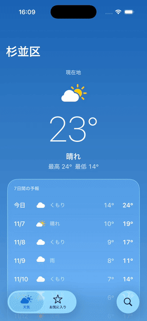
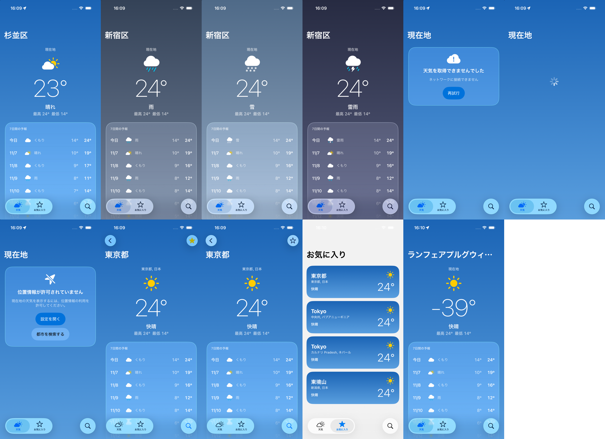

# reflex-expo-app

English | [日本語](README.ja.md)

An experiment in bringing Shopify's [Reflex](https://shopify.engineering/reflex) to Expo (React Native). Reflex is an architecture for mobile apps where agents write most of the code: the app's logic runs headlessly, every screen exposes its state and actions through one small contract, and a CLI drives that contract without a simulator.

The sample is a weather app with three tabs (current location, city search, favorites), styled for iOS 26 Liquid Glass. The UI text is in Japanese.

- API: [Open-Meteo](https://open-meteo.com/) (no API key)
- Native features: expo-location (permission, current position, reverse geocoding), expo-sqlite/kv-store (favorites)
- UI: Expo Router NativeTabs and native Stack, Expo UI (SwiftUI) `glassEffect`, multicolor SF Symbols

## Demo

The app in the simulator is driven entirely from the Metro debugger (CDP), without a single tap: switching the weather to rain and snow, going offline, denying location, then searching and opening a city.



(iPhone 17 Pro / iOS 26.5 simulator, Expo Go. [MP4](docs/cdp-demo/demo.mp4). Details in [docs/cdp-demo](docs/cdp-demo/README.md).)

Eleven screen states captured in 26 seconds:



## Overview

How each Reflex pillar maps to Expo:

| Reflex | This repository |
|---|---|
| A core with no UI (Swift package / JVM module) | `src/core`: TypeScript that imports no React, React Native, or Expo |
| A strict Elm-style ViewModel (action in, state out) | One store per screen. Only a pure `update` changes state; the only public entry point is `send(action)` |
| Services injected through the constructor | `Deps` (API, location, storage, navigation) passed to each screen factory |
| Introspection Kit (name / state / actions) | `describeScreen()`: shared by `ls` and `do` |
| CLI (`ls` / `do`) | `pnpm app-cli` (headless) and `globalThis.__app` in development builds (simulator) |
| Behavior tests (no network, fixtures everywhere, no mocking frameworks) | A harness on jest-expo. `fetch` always fails; fixtures recorded from real Open-Meteo responses are injected |

Reflex writes the code twice (Swift and Kotlin) and shares the tests to keep the two platforms in sync. React Native has a single codebase, so that motivation mostly goes away. The other benefit, verifying and exploring behavior quickly without a simulator, still applies. That is the premise of this experiment.

### What about navigation?

Expo Router keeps navigation state on the UI side (the JSX in `_layout.tsx`), so it can't run fully headless. Instead, the harness passes **`src/app` as is to `renderRouter` from `expo-router/testing-library`, replacing only the screen files with `() => null`**.

- Only the real layouts (navigators) render. Transitions, tabs, and back behave exactly like the app.
- Screen logic lives in the stores, so `ls` / `do` work without rendering the screens.
- The current screen is found by looking up the router's segments in `src/core/screens/registry.ts`.

The harness also reproduces two rules of the app:

- **Screen lifetime**: one store per router route. It's dropped when the route is popped (the same as unmounting).
- **Focus**: `Appear` is sent whenever focus moves to a screen (`useFocusEffect` in the app).

## Structure

```
src/
├── app/        Routes (Expo Router). Presentation only
├── core/       No UI, no React, no Expo (runs as is on Node)
│   ├── store.ts      createStore and the Screen type
│   ├── inspect.ts    Shared by ls / do
│   ├── deps.ts       Types of injected dependencies (Api / Location / Favorites / Nav)
│   ├── api.ts        Open-Meteo client (fetch is injected)
│   └── screens/      One ViewModel per screen, and the registry
├── platform/   Production implementations of the dependencies (expo-location, kv-store, expo-router)
├── ui/         Visual components (Expo UI / Liquid Glass) and the React glue (use-screen)
└── dev/        Development only (fixtures, fakes, scenarios, __app)
test/           Harness, behavior tests, boundary test
scripts/        app-cli
```

`test/boundaries.test.ts` checks that `src/core` never imports UI or Expo code.

A screen store looks like this (from `src/core/screens/weather.ts`):

```ts
export function createWeatherScreen(deps: Deps): Screen<WeatherState, WeatherAction> {
  const store = createStore<WeatherState, Msg>({ status: 'idle' }, update);
  return {
    name: 'Weather',
    actions: ['Appear', 'Retry', 'OpenSettings', 'OpenSearch'],
    getState: store.getState,
    subscribe: store.subscribe,
    hydrate: store.replace, // development only
    async send(action) {
      // Side effects call deps and feed the results back to update as messages
    },
  };
}
```

Components only subscribe and call `send`:

```tsx
const [state, send] = useScreen(() => createWeatherScreen(deps));
```

## Running

```bash
pnpm install
pnpm start          # Open in Expo Go (Liquid Glass needs iOS 26+)
pnpm test           # Behavior tests (no simulator)
```

### Driving the app without a simulator (app-cli)

```bash
pnpm app-cli ls
pnpm app-cli --url /search do ChangeQuery '{"query":"Tokyo"}' do Submit do Open '{"id":1850147}'
pnpm app-cli --scenario location-denied ls do OpenSearch
```

```
$ ls
  /  Weather
  state:   {"status":"permissionDenied","canAskAgain":false}
  actions: Appear, Retry, OpenSettings, OpenSearch
$ do OpenSearch
  /search  Search
  state:   {"query":"","status":"idle","results":[],"favorites":[]}
  actions: Appear, ChangeQuery, Submit, Open
  inputs:  {"ChangeQuery":{"query":"string"},"Open":{"id":"number"}}
```

Each call boots the app again, so chain commands to keep going in one session.

### Running the same tests as the native version

The same weather app also exists in Swift and Kotlin (not public yet), and its behavior tests run unchanged against this app. `test/protocol.test.tsx` is an adapter that speaks the same NDJSON protocol (`launch` / `ls` / `do` / `env`) over TCP from inside the harness.

```bash
REFLEX_PORT=8770 npx jest --no-watchman test/protocol.test.tsx   # listens on 127.0.0.1:8770
```

In the native version, the navigators lend `SelectTab` and `Back` to the focused screen, so the adapter maps them to expo-router transitions. Action inputs are checked against the types declared in the screen's `inputs` before `send` (the equivalent of Reflex's input schema).

### Driving the app in the simulator (__app)

Development builds expose `globalThis.__app`, which you call from the Metro debugger (CDP). It is not included in production bundles.

```js
__app.ls()                        // State and actions of the current screen
__app.do('Open', { id: 1850147 }) // Send an action (no button involved)
__app.go('/favorites')            // Navigate (like tapping a tab or opening a deep link)
__app.scenario('rainy')           // Swap dependencies for a scenario ('default' restores them)
__app.hydrate({ ... })            // Replace the current screen's state directly
```

Scenarios (`src/dev/scenarios.ts`) are shared with app-cli.

| Scenario | What it does |
|---|---|
| `fixtures` | Same data every time, no network |
| `rainy` / `snowy` / `stormy` | Fixtures with the weather code rewritten |
| `many-favorites` | Several favorites |
| `offline` | No connection |
| `loading` | The response never arrives |
| `location-denied` | Location permission already denied |

A scenario only swaps the injected dependencies, so state still goes through the real `update`. That means you can only reproduce screens that can actually happen.

## Findings

### Speed

The same task (search → detail → toggle favorite → back → check the favorites tab) done three ways:

| Method | The operations themselves | Time seen by the agent | Tool calls |
|---|---|---|---|
| app-cli (headless) | ~50ms for 7 operations | 2.3–3.0s (mostly jest startup) | 1 |
| `__app` over CDP, one call per operation | 275ms for 7 operations | 14.0s | 8 |
| UI automation with argent (best case, coordinates known) | ~3.2s | 10.0s | 1 |

The 19 behavior tests take about 0.8s in total (5–85ms each).

For an agent, what matters most is the number of tool calls. The CLI can chain commands into a single call. UI automation on an unfamiliar screen has to look up coordinates at every step, so it grows to 10–20 calls.

### What headless tests catch, and what only a device catches

**Reproduced by headless tests and guarded against regressions**

- After granting location in Settings and coming back, the screen still showed the denied state
- Once loaded, switching tabs must not refetch
- On iOS, after one denial the app can never ask again (`canAskAgain: false`). Testing it only takes a change to the fake

**Found only on a device (simulator)**

- Typing fast swapped characters. The input value was round-tripping through the store back into the TextInput
- Opening the app from its icon started on the search tab. Fixed with `anchor` on the root layout. The harness always starts on the right tab for any URL, so it can't reproduce this
- Card text was unreadable on the snowy sky. Found by laying out screen states with scenarios

This ends up with the same split as Reflex: behavior headless, visuals and wiring on a device (Reflex covers visuals with Helix's visual review).

The workflow that worked best:

- **Getting to the target screen and state**: jump there with `do` / `scenario`
- **Checking visuals and wiring**: only from there, with taps and screenshots

### Design decisions

- **No state management library.** The hand-written `createStore` is about 20 lines and nearly the same as `zustand/vanilla`. Zustand exposes `setState`, which makes the "only `send` is public" rule harder to keep.
- **Cross-screen state: storage is the source of truth, re-read on every focus.** Favorites span three screens, and each of them re-reads kv-store on `Appear`. Screens don't need to know about each other, and tests stay per-screen. If you need an app-wide store (for example, two screens visible at once that must sync instantly), injecting a `zustand/vanilla` store through `Deps` seems like the natural next step.
- **Not a monorepo.** The harness renders the real expo-router, so even if core were a separate package, the tests would still run on jest-expo. `test/boundaries.test.ts` guards the boundary.
- **iOS-only visuals live in `.ios.tsx`.** Expo UI (SwiftUI) components are in `.ios.tsx`, with an Android fallback in the `.tsx` of the same name. Not verified on a real Android device.

## Limitations and next steps

- app-cli boots jest on every call, which takes about 2 seconds. A REPL that keeps the harness running would answer each operation in a few milliseconds.
- ESLint isn't set up. The core boundary could also be enforced with a lint rule (`no-restricted-imports`).
- Reloading when coming back from the Settings app (AppState becoming active) isn't implemented.
- `__app.hydrate` doesn't validate the state shape, so it accepts combinations `update` would never produce.
