# シミュレータのアプリを CDP から操作して、11 の画面パターンを 26 秒で撮る

[English](README.md) | 日本語

Expo の天気アプリを、ボタンを一度も押さずに操作します。使うのは Metro のデバッガー（CDP）だけです。天気を雨や雪に変え、通信を切り、位置情報を拒否し、検索から詳細画面まで進めて、場面ごとにスクリーンショットを撮りました。

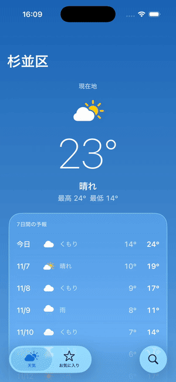

（iPhone 17 Pro / iOS 26.5 シミュレータ、Expo Go。[MP4 版](./demo.mp4)）

## 何をしているか

このアプリは、画面ごとのロジックを UI から切り離した「ストア」に置いています。状態を変えるのは純粋な `update` だけで、外から触れるのは `send(action)` だけです（詳しくはリポジトリの [README](../../README.ja.md)）。

開発ビルドでは、この口を `globalThis.__app` として公開しています。

```js
__app.ls()                        // 今の画面の名前・state・送れるアクション
__app.do('Open', { id: 1850147 }) // アクションを送る（ボタンは経由しない）
__app.go('/favorites')            // 遷移する
__app.scenario('rainy')           // 依存（API・位置情報・保存）をシナリオに差し替える
__app.hydrate({ ... })            // 今の画面の state を直接入れる
```

これを Node から CDP の `Runtime.evaluate` で呼ぶのが [`scripts/cdp.mjs`](../../scripts/cdp.mjs) です。1 回の接続で式を順に評価し、結果と所要時間を出します。

```console
$ node scripts/cdp.mjs "__app.scenario('rainy')" "__app.do('Retry').then(s => s.state.forecast.current)"
$ __app.scenario('rainy')  (3ms)
  "rainy"
$ __app.do('Retry').then(s => s.state.forecast.current)  (80ms)
  {"code":63,"temperature":23.5}
```

デモ全体は [`run.sh`](./run.sh) です。CDP で状態を作り、[agent-device](https://github.com/callstackincubator/agent-device) でスクリーンショットを撮る、を繰り返します。全ログは [`log.txt`](./log.txt) にあります。

## 1. 天気を変える

シナリオを差し替えて `Retry` を送るだけです。シナリオはフィクスチャの天気コードを書き換えた API を注入します。state は正規の `update` を通って作られるので、実際に起こりうる画面だけが出ます。

```js
__app.scenario('snowy')
__app.do('Retry')   // → {"code":73,"temperature":23.5}  52ms
```

| 実ネットワーク | 雨 | 雪 | 雷雨 |
|---|---|---|---|
| 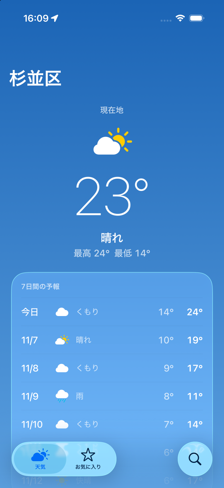 | 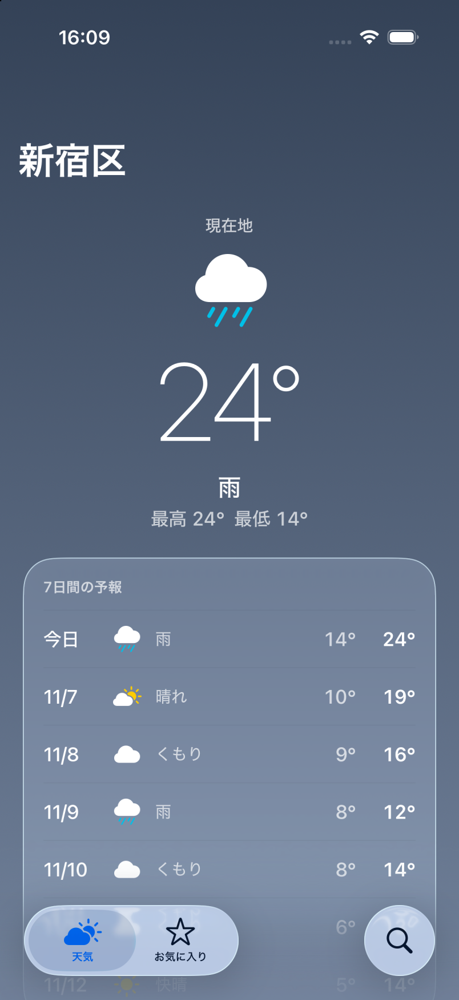 | 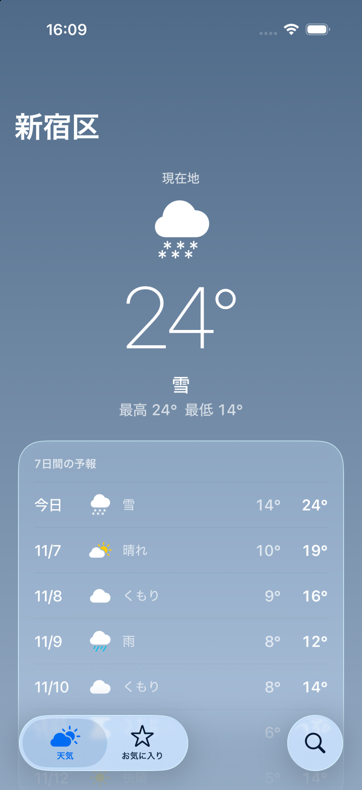 | 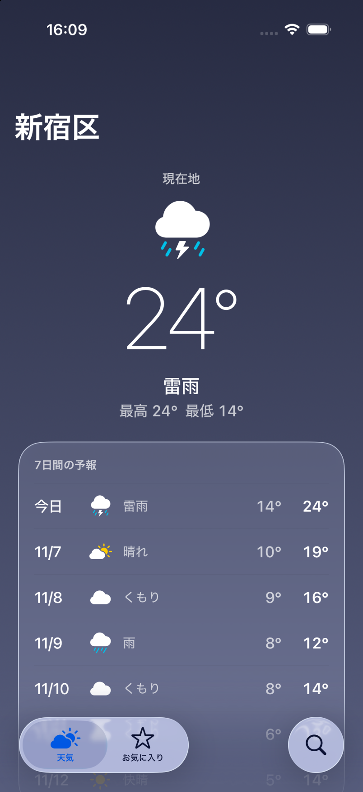 |

## 2. 本物の端末では作りにくい状態

通信断、応答が返らない、位置情報を一度拒否した、の3つです。実機で作ろうとすると、機内モードにしたり、アプリを消して入れ直して拒否し直したりすることになります。ここではどれも 20ms 以内で切り替わりました。

```js
__app.scenario('offline');         __app.do('Retry')  // {"status":"error","message":"ネットワークに接続できません"}
__app.scenario('loading');         __app.do('Retry')  // {"status":"loading"}（返らないので待たない）
__app.scenario('location-denied'); __app.do('Retry')  // {"status":"permissionDenied","canAskAgain":false}
```

| オフライン | 読み込み中 | 位置情報を拒否済み |
|---|---|---|
| 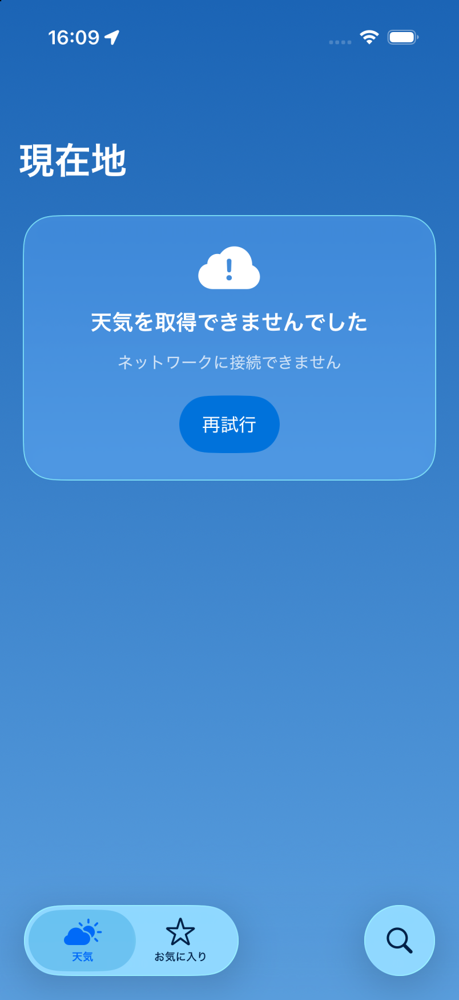 | 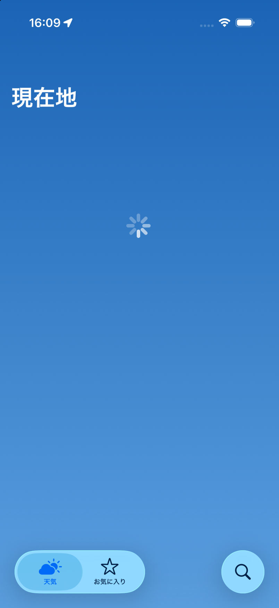 | 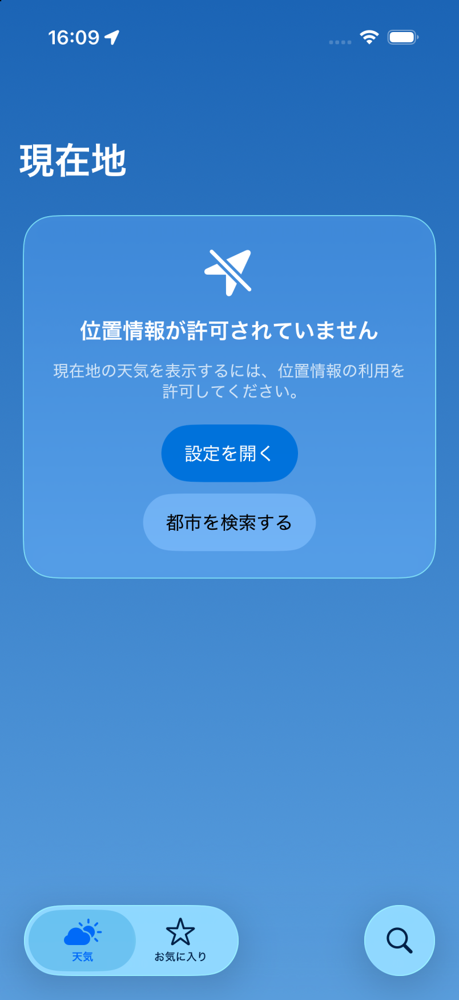 |

## 3. 検索 → 詳細 → お気に入り

キーボードも検索ボタンもタップしません。アクションを送るだけで、本物の native Stack が push されます。

```js
__app.go('/search')
__app.do('ChangeQuery', { query: 'Tokyo' })
__app.do('Submit')               // ["東京都 / 東京都, 日本", "Tokyo / 中央州, パプアニューギニア", ...]
__app.do('Open', { id: 1850147 })
__app.do('ToggleFavorite')       // favorite: true → false
```

| 詳細（お気に入り済み） | お気に入りを外した | お気に入りが4件 |
|---|---|---|
| 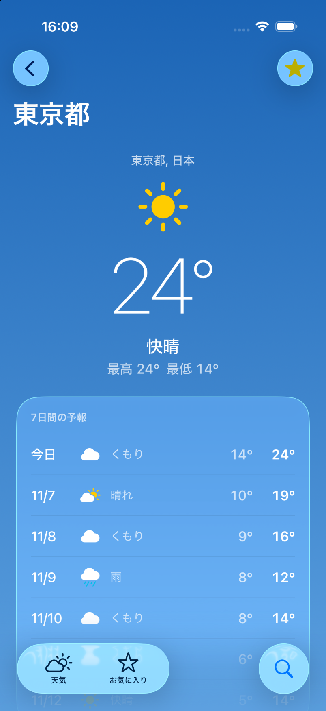 |  | 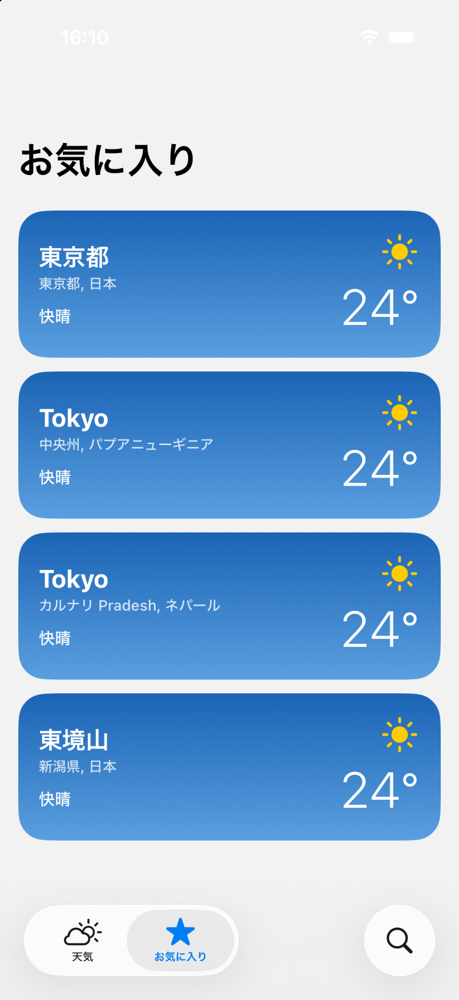 |

## 4. hydrate で境界値を入れる

`hydrate` は `update` を通さずに state を入れます。とても長い地名と −38.6℃ を入れて、見た目が崩れないかを見ました。地名は 1 行で省略され、気温は「−39°」と表示されます。

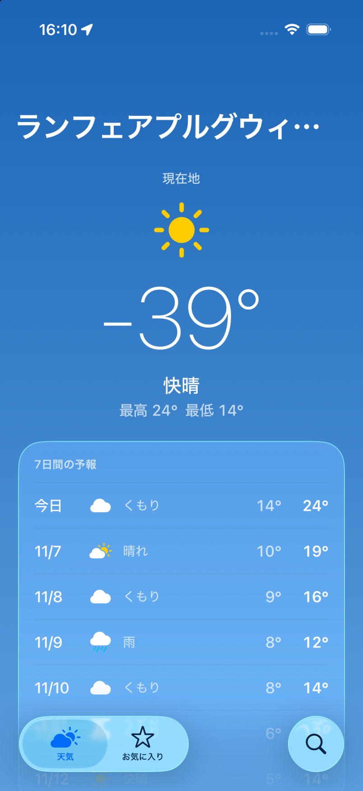

ただし、`hydrate` は型を検証しません。「最高 24° 最低 14° なのに今は −39°」のような、`update` が作らない組み合わせも入れられます。見た目の境界値を確かめる用途に限って使っています。

## 速さ

`run.sh` は 31 回の CDP 呼び出しと 11 枚のスクリーンショットで、全体 26 秒でした。ほとんどはスクリーンショット（描画待ち 0.8 秒＋撮影）の時間です。

| 内訳 | 回数 | 時間 |
|---|---|---|
| 同期の操作（`scenario` / `go` / `ls` / `hydrate`） | 15 | 1〜6ms |
| フィクスチャを読むアクション（`Retry` / `Submit` / `Open` など） | 10 | 13〜217ms |
| 実ネットワークへの `Retry`（Open-Meteo） | 2 | 0.4〜0.9 秒 |
| 遷移のあとフォーカスが移るまでの待ち | 4 | 約 0.3 秒ずつ |

ネットワークと意図的な待ちを除くと、25 回の操作で合計 0.67 秒です。座標を探してタップする UI 操作は 1 タップあたり数百 ms〜数秒かかるので、「目的の画面と状態まで連れて行く」部分は CDP に任せ、見た目の確認だけをスクリーンショットでやる、という分担がいちばん速くなりました。

## 見つかったもの

### お気に入り画面のステータスバーが読めない

10 枚目をよく見ると、時刻とバッテリーが白いまま、明るい背景に乗っています。


天気と詳細の画面は空のグラデーションの上なので `<StatusBar style="light" />`（`src/ui/sky-scroll-view.tsx`）を置いています。お気に入り画面はこれを置いておらず、前の画面の `light` がそのまま残っていました。CDP 特有の現象ではなく、天気タブからお気に入りタブを実際にタップしても同じになることを確かめました。

ヘッドレスのテストでは描画しないので見つかりません。画面のパターンを並べて撮ったことで気づけました。

### CDP につなぐときのはまりどころ

- **Origin ヘッダーが要る**：Expo SDK 58 の Metro は、Origin が `http://127.0.0.1:<port>` でない DevTools 接続を拒否します。Origin なしだと 401、`http://localhost:<port>` だと接続直後に 1006 で切られました。
- **Hermes は `awaitPromise` に対応していない**：`Runtime.evaluate` に `awaitPromise: true` を付けても Promise オブジェクト（`{"_x":0,...}`）がそのまま返ります。`cdp.mjs` では、Promise なら結果を `globalThis.__cdp` に書かせて 5ms ごとに読みに行くようにしました。
- **遷移はすぐには終わらない**：`__app.go()` や `Open` の直後に `do` を送ると、フォーカスがまだ前の画面にあり「Weather に ChangeQuery はない」と返ります。今は 300ms 待っています。`go` がフォーカスの移動を待って返るようにすれば、この待ちは消せます。

## 再現する

```bash
pnpm start --port 8082          # Expo Go で開いておく
AD=<agent-device のパス> docs/cdp-demo/run.sh
```

`cdp.mjs` は `--port`（既定 8082）と `--device`（既定 `iPhone 17 Pro`、`/json/list` の title で照合）で接続先を変えられます。
