# Driving the simulator app over CDP: 11 screen states in 26 seconds

English | [日本語](README.ja.md)

This drives the Expo weather app without pressing a single button, using only the Metro debugger (CDP). It switches the weather to rain and snow, goes offline, denies location, searches and opens a city, and takes a screenshot of each state.

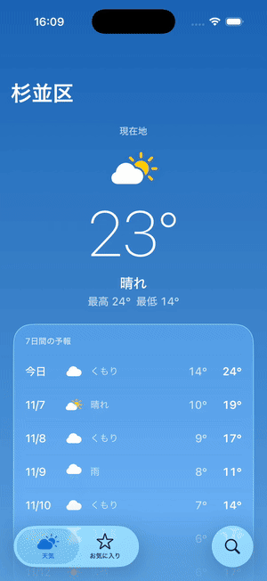

(iPhone 17 Pro / iOS 26.5 simulator, Expo Go. [MP4](./demo.mp4))

## What's going on

The app keeps each screen's logic in a "store" separated from the UI. Only a pure `update` changes state, and the only way in from outside is `send(action)` (see the repository [README](../../README.md)).

Development builds expose that entry point as `globalThis.__app`.

```js
__app.ls()                        // Name, state, and accepted actions of the current screen
__app.do('Open', { id: 1850147 }) // Send an action (no button involved)
__app.go('/favorites')            // Navigate
__app.scenario('rainy')           // Swap dependencies (API, location, storage) for a scenario
__app.hydrate({ ... })            // Replace the current screen's state directly
```

[`scripts/cdp.mjs`](../../scripts/cdp.mjs) calls these from Node through CDP's `Runtime.evaluate`. It evaluates expressions in order over one connection and prints each result with its duration.

```console
$ node scripts/cdp.mjs "__app.scenario('rainy')" "__app.do('Retry').then(s => s.state.forecast.current)"
$ __app.scenario('rainy')  (3ms)
  "rainy"
$ __app.do('Retry').then(s => s.state.forecast.current)  (80ms)
  {"code":63,"temperature":23.5}
```

The whole demo is [`run.sh`](./run.sh): set up a state over CDP, take a screenshot with [agent-device](https://github.com/callstackincubator/agent-device), repeat. The full log is in [`log.txt`](./log.txt).

## 1. Changing the weather

Swap the scenario and send `Retry`. The scenario injects an API whose fixture has a rewritten weather code. State still goes through the real `update`, so only screens that can actually happen show up.

```js
__app.scenario('snowy')
__app.do('Retry')   // → {"code":73,"temperature":23.5}  52ms
```

| Live network | Rain | Snow | Thunderstorm |
|---|---|---|---|
| 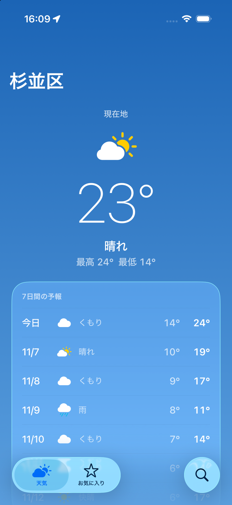 | 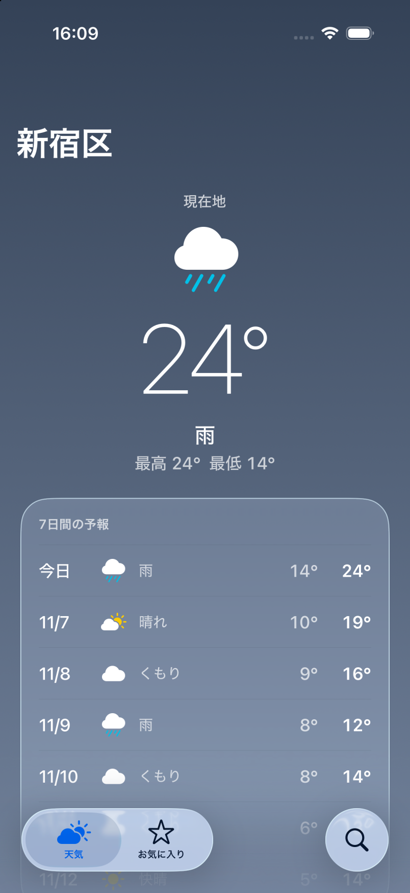 | 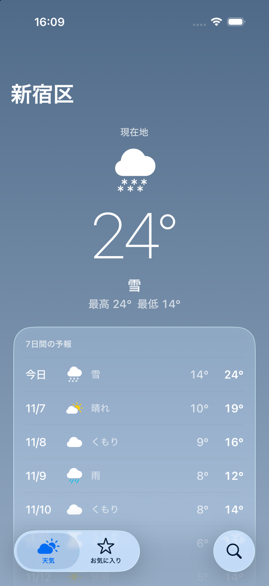 | 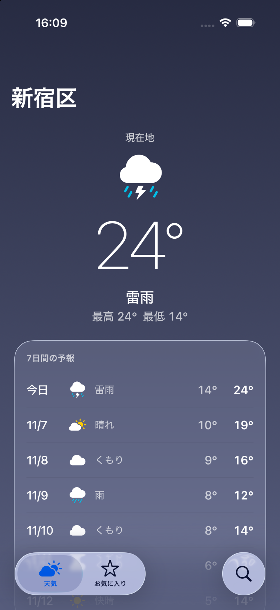 |

## 2. States that are hard to reach on a real device

No connection, a response that never arrives, and location already denied. On a real device you would toggle airplane mode or reinstall the app to deny permission again. Here each one switches in under 20ms.

```js
__app.scenario('offline');         __app.do('Retry')  // {"status":"error","message":"ネットワークに接続できません"}
__app.scenario('loading');         __app.do('Retry')  // {"status":"loading"} (never resolves, so don't wait)
__app.scenario('location-denied'); __app.do('Retry')  // {"status":"permissionDenied","canAskAgain":false}
```

| Offline | Loading | Location denied |
|---|---|---|
| 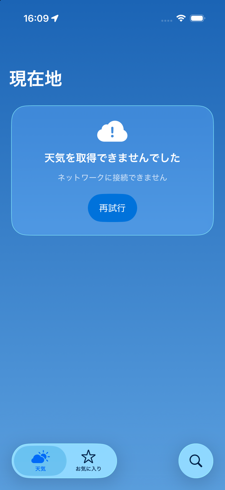 | 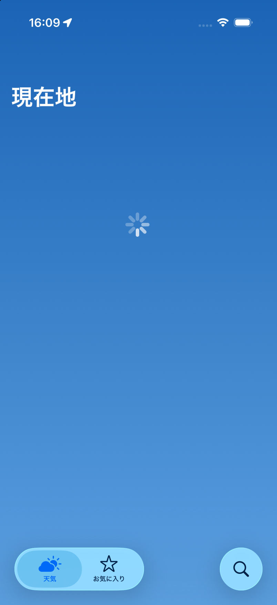 | 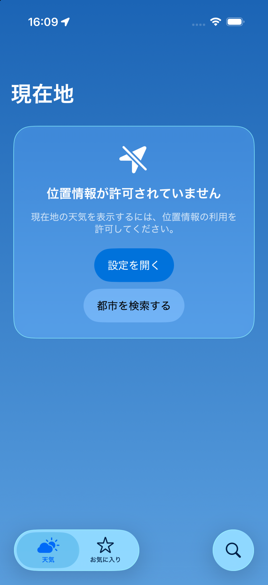 |

## 3. Search → detail → favorite

No keyboard and no search button. Sending actions pushes the real native Stack.

```js
__app.go('/search')
__app.do('ChangeQuery', { query: 'Tokyo' })
__app.do('Submit')               // ["東京都 / 東京都, 日本", "Tokyo / 中央州, パプアニューギニア", ...]
__app.do('Open', { id: 1850147 })
__app.do('ToggleFavorite')       // favorite: true → false
```

| Detail (favorited) | Unfavorited | Four favorites |
|---|---|---|
| 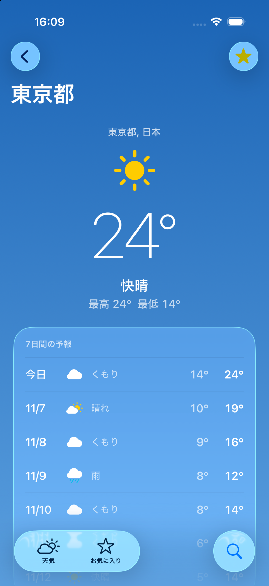 |  | 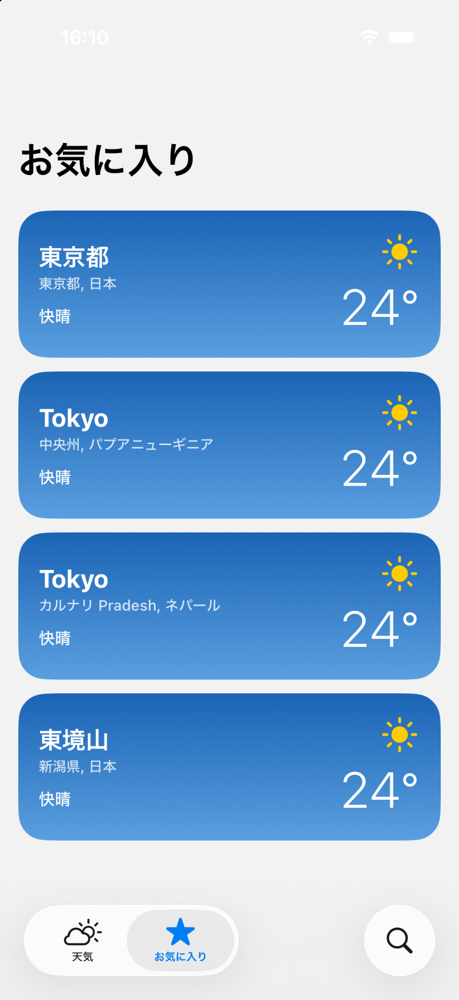 |

## 4. Boundary values with hydrate

`hydrate` puts state in without going through `update`. Here it's a very long place name and −38.6℃, to see whether the layout holds. The name is truncated to one line and the temperature shows as "−39°".

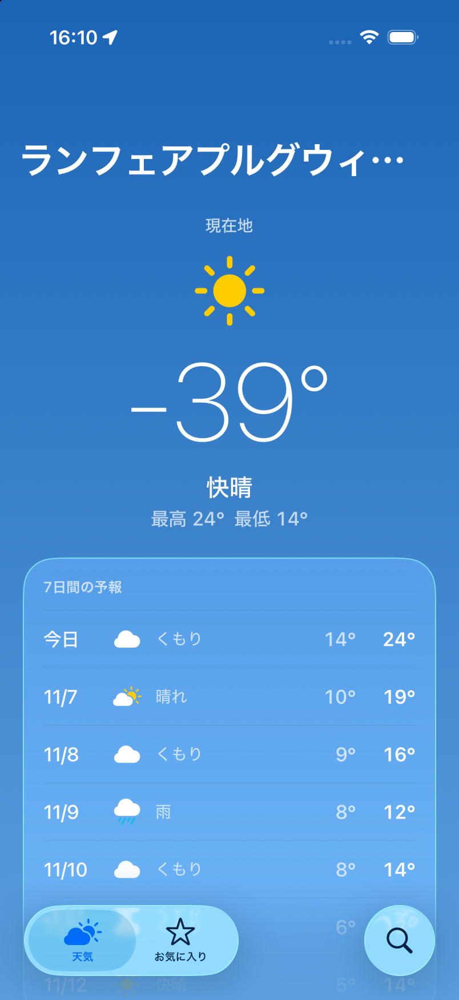

`hydrate` doesn't validate the state, though. It accepts combinations `update` never produces, like "high 24°, low 14°, but −39° right now". Use it only for checking visual boundary values.

## Speed

`run.sh` made 31 CDP calls and took 11 screenshots in 26 seconds overall. Most of that is screenshots (0.8s wait for rendering plus capture).

| Breakdown | Count | Time |
|---|---|---|
| Synchronous operations (`scenario` / `go` / `ls` / `hydrate`) | 15 | 1–6ms |
| Actions that read fixtures (`Retry` / `Submit` / `Open`, etc.) | 10 | 13–217ms |
| `Retry` against the live network (Open-Meteo) | 2 | 0.4–0.9s |
| Waiting for focus to move after navigation | 4 | ~0.3s each |

Excluding the network and the deliberate waits, 25 operations took 0.67s in total. UI automation that finds coordinates and taps takes hundreds of milliseconds to seconds per tap, so the fastest split was: CDP takes you to the target screen and state, and screenshots are used only to check the visuals.

## What it found

### The status bar is unreadable on the favorites screen

Look closely at the 10th screenshot: the clock and battery stay white on a light background.


The weather and detail screens sit on a sky gradient, so they render `<StatusBar style="light" />` (`src/ui/sky-scroll-view.tsx`). The favorites screen doesn't, so the previous screen's `light` stays in effect. It isn't specific to CDP: tapping from the weather tab to the favorites tab by hand does the same.

Headless tests never render, so they can't catch this. Laying out the screen states side by side did.

### Gotchas when connecting over CDP

- **An Origin header is required**: Metro in Expo SDK 58 rejects DevTools connections whose Origin isn't `http://127.0.0.1:<port>`. Without an Origin it returns 401; with `http://localhost:<port>` the connection is closed with 1006 right after it opens.
- **Hermes ignores `awaitPromise`**: with `awaitPromise: true` on `Runtime.evaluate`, you still get the Promise object back (`{"_x":0,...}`). `cdp.mjs` makes a Promise write its result to `globalThis.__cdp` and polls it every 5ms.
- **Navigation doesn't finish immediately**: sending `do` right after `__app.go()` or `Open` hits the previous screen, which still has focus ("Weather に ChangeQuery はない"). For now it waits 300ms. Making `go` wait until focus moves would remove that wait.

## Reproducing

```bash
pnpm start --port 8082          # keep it open in Expo Go
AD=<path to agent-device> docs/cdp-demo/run.sh
```

`cdp.mjs` takes `--port` (default 8082) and `--device` (default `iPhone 17 Pro`, matched against the title in `/json/list`) to pick the target.
